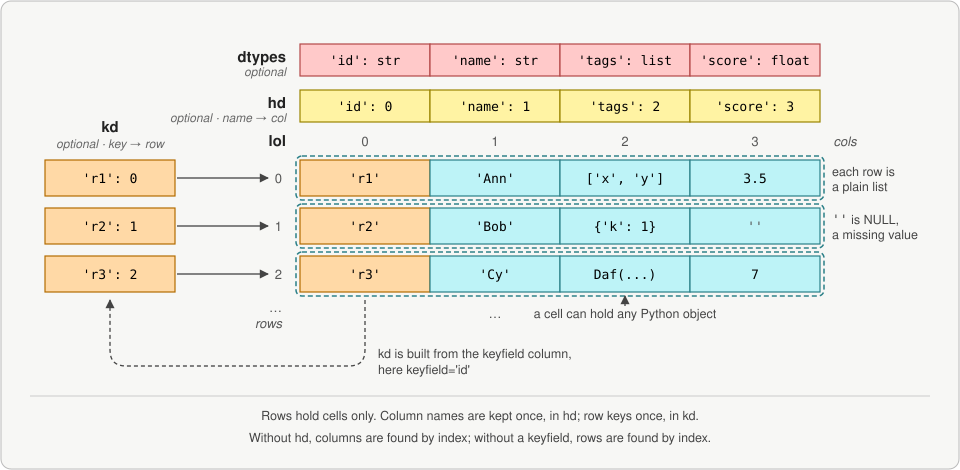

# Daf overview

::: daffodil.daf.Daf
    options:
      members: false

## Names in the signatures

The signatures use short names for types. Each is `T_` and then letters for the type, read
from the outside in. They are defined in `daffodil.lib.daf_types`.

| Letter | Means |
| :----- | :---- |
| `l` | a list |
| `d` | a dict with str keys |
| `id` | a dict with int keys |
| `t` | a tuple |
| `s`, `i`, `f`, `b` | str, int, float, bool |
| `a` | any value |
| `o` | "of", between two parts |

So `T_ls` is a list of str, `T_da` is a dict of any values, `T_lola` is a list of lists of any
values, the rows of a Daf, and `T_dols` is a dict of lists of str. A few names do not follow
the scheme:

| Name | Means |
| :--- | :---- |
| `T_cs` | column names: a list of str, the keys of a dict, or a dict |
| `T_ma` | a row as a dict or a [KeyedList][daffodil.keyedlist.KeyedList] |
| `T_klodaf` | a KeyedList of Dafs, one for each group, as `groupby()` gives |
| `T_dtype_dict` | a dict of column name to type, as `dtypes` |
| `T_lor` | a list of ranges |

A default of `_MISSING` means that no value was given. It lets `None` be a real value that you
pass. For example, `to_value()` with no `default` raises for an empty selection, and with
`default=None` it returns None.

## Constructor

::: daffodil.daf.Daf.__init__

## Class constants

::: daffodil.daf.Daf.COPY_NONE

::: daffodil.daf.Daf.COPY_ROWS

::: daffodil.daf.Daf.COPY_HD

::: daffodil.daf.Daf.COPY_KD

::: daffodil.daf.Daf.COPY_DTYPES

::: daffodil.daf.Daf.COPY_ATTRS

::: daffodil.daf.Daf.COPY_OUTER

::: daffodil.daf.Daf.copy_level_default

::: daffodil.daf.Daf.RETMODE_OBJ

::: daffodil.daf.Daf.RETMODE_VAL

::: daffodil.daf.Daf.ITERMODE_DICT

::: daffodil.daf.Daf.ITERMODE_KEYEDLIST

::: daffodil.daf.Daf.TYPE_MAP

